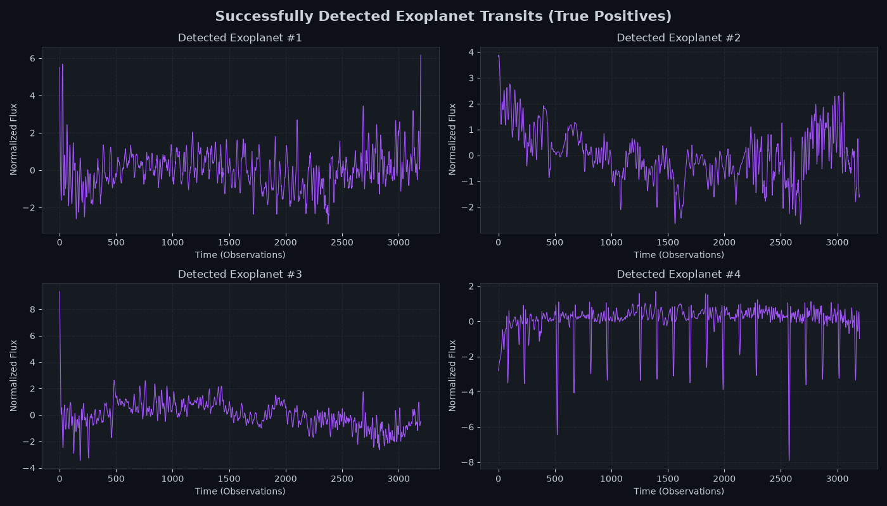
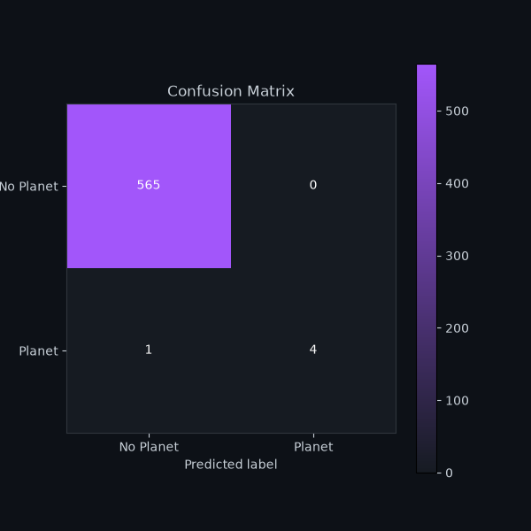
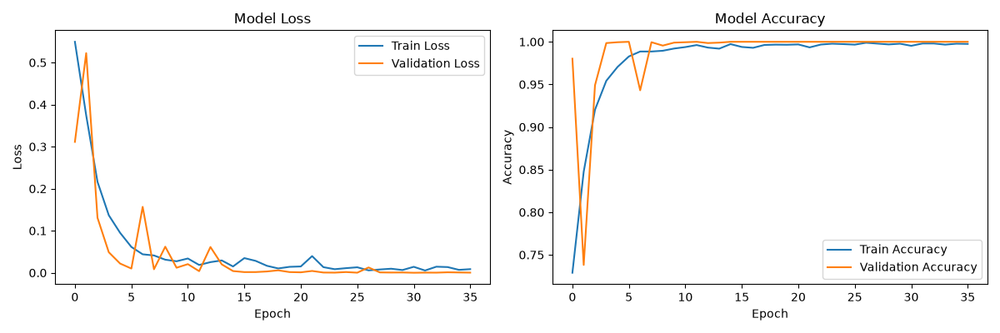

# Exoplanet Detection from Kepler Light Curves

A machine learning pipeline for detecting exoplanet transits from highly imbalanced space telescope data, featuring signal smoothing and a 1D Convolutional Neural Network. Built to tackle the "accuracy paradox" in astronomical data processing.

The pipeline processes raw light flux measurements, filtering out high-frequency cosmic noise, and uses deep learning to identify the subtle dips in brightness caused by planets passing in front of their host stars. 

## How to run

### 1. Install the tools
You need three programs installed on your computer:
- **Python 3** from python.org. On Windows, tick the option "Add Python to PATH" in the installer.
- **Git** from git-scm.com.
- **Visual Studio Code** from code.visualstudio.com. Optionally, install the "Python" extension from the Extensions tab (the square icon on the left side).

### 2. Download the project
1. Choose a place on your computer where the project should be saved, for example the Desktop.
2. Open a terminal there. On Windows, you can right-click an empty space in the folder and choose **Open in Terminal**, or open PowerShell and move to the folder with `cd Desktop`.
3. Type `git clone https://github.com/StanekJan02/exoplanet_detector.git` and press Enter. 

Git creates a new folder named `exoplanet_detector` with all the project files inside.

### 3. Open the project in VS Code
1. Open Visual Studio Code.
2. In the top menu click **File**, then **Open Folder**.
3. Select the `exoplanet_detector` folder and confirm.

The project files (`data`, `src`, `assets`, `README.md` and others) now appear in the Explorer panel on the left.

### 4. Open the terminal in VS Code
In the top menu click **Terminal**, then **New Terminal**. A terminal panel opens at the bottom of the window. The path shown in it should end with `exoplanet_detector`, which means you are in the project folder and can type commands there.

### 5. Install the dependencies
In the terminal type `pip install -r requirements.txt` and press Enter. This installs TensorFlow, SciPy, scikit-learn, imbalanced-learn, pandas, and matplotlib. Wait until the installation finishes and the cursor appears again.

### 6. Run the pipeline
In the same terminal type `python src/trainer.py` and press Enter. If Windows says that python is not recognized, use `py src/trainer.py` instead.

The script prints the training progress (epochs) and validation metrics in the terminal. When it finishes training (or when EarlyStopping halts it), a window with the plots opens. 

### 7. See the results
The generated plots (Confusion Matrix, Training History, and Smoothed Signal) will appear on your screen. You can also view the pre-generated plots directly in the `assets/` folder by clicking them in the VS Code Explorer panel.

## How it works

The system processes noisy continuous light flux data to classify whether a star has a confirmed exoplanet transit.

1. **Data preparation:** The original labels are mapped to a standard binary format (0 for normal stars, 1 for exoplanet systems).
2. **Signal Smoothing:** A Savitzky-Golay filter (window=15, polyorder=3) is applied to the raw signal. This mathematical filter is crucial because it reduces high-frequency background noise while preserving the strict depth and sharp edges of transit valleys.
3. **Scaling:** A standard scaler is applied to center the light flux variations around zero.
4. **Balancing (SMOTE):** Since over 99% of stars do not show transits, the training data is extremely imbalanced. SMOTE is applied *only* to the training set to generate synthetic minority samples, forcing the network to learn planetary features.
5. **Local training (1D CNN):** The model architecture consists of two `Conv1D` blocks with `MaxPooling1D` for feature extraction, followed by `Flatten` and `Dense` layers. A `Dropout(0.2)` layer is used to prevent overfitting.
6. **Evaluation:** The final global model is evaluated on a strictly unseen, naturally imbalanced test set to expose its real-world sensitivity via a Confusion Matrix.

## Dataset

"Exoplanet Hunting in Deep Space" dataset from Kaggle, containing light curves from the Kepler Space Observatory. Each record represents 3,197 continuous light flux measurements for a single star over time. The target is whether the star has a confirmed exoplanet transit. 

The dataset is split into `exoTrain.csv` (5,087 records) and `exoTest.csv` (570 records) and is located in the `data/` directory.

## Results





- **Baseline (always predict "no planet"):** ~99.1% overall accuracy.
- Without signal smoothing, the base 1D CNN caught only 1 out of 5 actual planets (True Positives) in the test set, losing the transit signature in the noise.
- Implementing the Savitzky-Golay filter doubled the model's sensitivity, capturing 2 out of 5 planets.
- The trade-off for higher sensitivity is a slight increase in False Positives. In astronomical pipelines, this is the preferred behavior, as it is cheaper to manually verify a few false alarms than to permanently miss a new exoplanet.

## Limitations

- The model still misses very faint or rapid transits (3 False Negatives remain in the test set).
- The Savitzky-Golay parameters are static. Dynamic window sizing based on individual stellar noise profiles might yield better signal-to-noise ratios.
- A relatively shallow CNN architecture was used to prioritize training speed; deeper architectures with residual connections might capture more complex transit patterns.
- Accuracy is a weak metric for imbalanced data. The Confusion Matrix is the primary source of evaluation in this pipeline.

## Project structure

```text
├── assets/                        # generated plots
│   ├── confusion_matrix.png
│   ├── history.png
│   └── signal.png
├── data/
│   ├── exoTrain.csv               # training dataset
│   └── exoTest.csv                # separate test dataset
├── src/
│   ├── config.py                  # hyperparameters and paths
│   ├── data_processor.py          # ETL, SMOTE, and smoothing logic
│   ├── model_builder.py           # 1D CNN architecture
│   ├── trainer.py                 # training pipeline and early stopping
│   └── visualizer.py              # matplotlib charts
├── .gitignore
├── README.md
└── requirements.txt